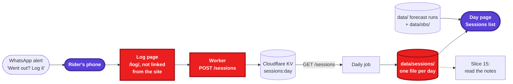
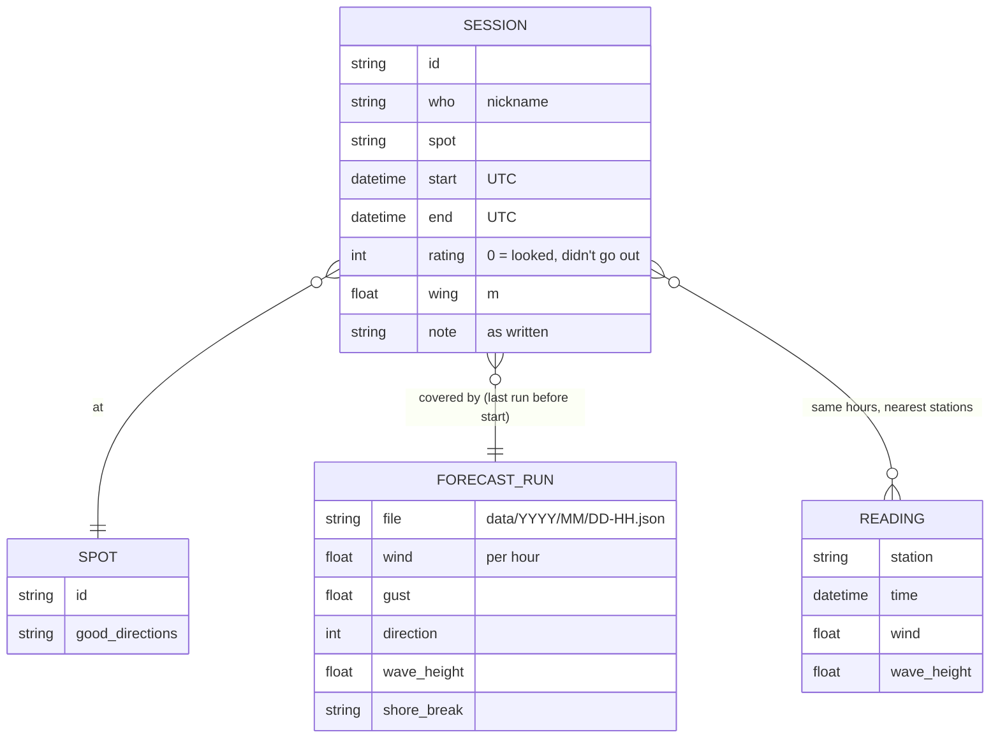
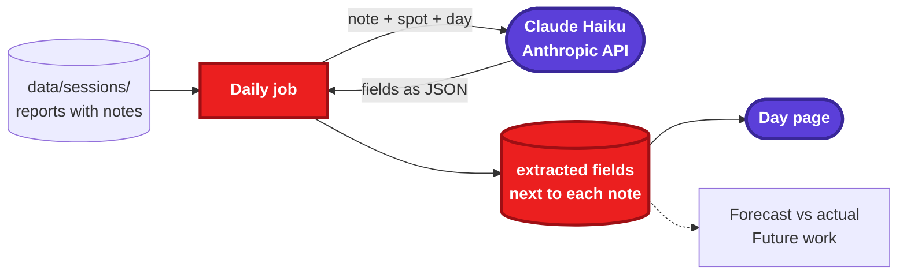

# Session log spec

Part of the [wing-alert spec](wing-alert.md), split out so it can change without touching the main file. Same rules: requirement IDs (`FR-14.x`, `FR-15.x`) are unique across both files, and "Setup David does once" stays in the main spec.

## Slice 14: Session log

Branch `feat/session-log`.

The forecast says what *should* have happened, the buoys say what blew offshore, but only the riders know how it was at the spot: chop, shore break, gusts, which wing. A crew member already sent a report like this on 4 Nov 2026: Arklow, 15:45–16:30, "full on chop, shore break medium, stable wind, 4.5–5.0 m, 3/5". This slice makes that a 10-second job and keeps every report next to the forecast and readings for that day, so later we can check and tune the scoring against it (slice 15, and "Forecast vs actual" in Future work).

**Only ask for what we can't measure.** Wind, gusts, direction, waves and tide for that spot and hour are already in `data/`. A report is just who, where, when and how it was. The conditions get joined in when someone reads it, never typed in again.



The log page on a phone:

```text
Log a session                         you: dave  (change)
Spot   [ Arklow            ▾ ]        Day  [ Wed 4 Nov ▾ ]
Time   [ 15:45 ] – [ 16:30 ]
How was it?   ☆ ☆ ☆ ☆ ☆      [ Looked, didn't go out ]
Wing   [ 4.5 ]  m   (optional)
Notes  ┌──────────────────────────────────────────┐
       │ full on chop, shore break medium, wind   │   ← type or dictate
       │ stable, beginners would hate it          │
       └──────────────────────────────────────────┘
       Everything here is public on the site, under your nickname.
                                              [ Send ]
```

### Who's who: a nickname, no login

For now this is just the crew, so we trust each other: no accounts, no passwords, no tokens. Login can come later if we ever need it ([Future work](wing-alert.md#future-work)).

- **FR-14.1** The first time you open the log page, it asks for a **nickname** (1–20 letters, digits, `-` or `_`) and keeps it in the phone's browser (`localStorage`). Every later report uses it; "change" next to it lets you pick another. Nicknames aren't checked or reserved.
- **FR-14.2** The log page is at `/log/` on the site and **isn't linked from any page**. Only people who are sent the link can find it easily. The repo is public, so this keeps casual visitors out, not someone who reads the source; the guards in FR-14.7 cover the rest.

### Logging a session

- **FR-14.3** **The link in the alert:** every WhatsApp alert ends with `Went out? Log it: https://daplein.github.io/wing-alert/log/?spot=arklow&day=2026-11-04&from=14&to=16`, for the alert's best window. The page fills in the spot, day and times from the link; with no link values it picks today, the last spot used, and no times.
- **FR-14.4** **A report** is: spot (from `spots.yaml`, or "other" with a place name), day, start and end time (optional), a rating 1–5 or **"Looked, didn't go out"** (stored as 0, because the days we skip matter as much as the good ones), wing size in m (optional), and a free-text note (optional, up to 1000 characters). Only the spot, day and rating are required, so a report can be two taps.
- **FR-14.5** **The note is free text on purpose.** Riders type or dictate it with the phone keyboard's microphone; there are no fields for chop, shore break or gusts. The text is always kept as written; slice 15 reads the fields out of it.
- **FR-14.6** **Fixing a report:** the page remembers the reports it sent (their ids, in `localStorage`). Sending again from the same phone for the same spot and day replaces the earlier report, for up to 7 days. Anything else (deleting one, fixing an old one) David does by hand in `data/sessions/`.

### Storing it

- **FR-14.7** The Worker answers `POST /sessions` and **checks every report** before storing it: the spot is known (or "other" with a place name up to 40 characters), the day is today or up to 7 days back, the rating is 0–5, the wing is 1–15 m, the times are in order, the note is no longer than 1000 characters, and the nickname follows FR-14.1. Anything else gets a 400 with the reason, and the page shows it. These guards are there from day one:
  - At most 50 reports a day across everyone. More than that is abuse or a bug, so the Worker answers 429 and logs it.
  - A Worker variable `SESSIONS_OPEN`; set it to `false` and the Worker refuses every report (the page says logging is closed). That's the off switch if it's ever abused.
  - CORS only allows the Pages site, so other web pages can't post from a visitor's browser.
- **FR-14.8** Reports are stored in Cloudflare KV under one key per day (`sessions:2026-11-04`, the day of the session), each with an `id`, the fields above, `who` (nickname) and `sent` (UTC). Times are stored in UTC, like the readings ([FR-10.8](wing-alert.md#slice-10-live-readings)); the page converts them from and to Irish time. Keys expire 14 days after their last write; git keeps the history (FR-14.9).
- **FR-14.9** The Worker answers `GET /sessions?day=2026-11-04` like `/obs` ([FR-10.5](wing-alert.md#slice-10-live-readings)): public JSON, CORS `*`, cached 5 minutes. The daily job fetches the last 8 days and merges them into `data/sessions/<day>.json` by `id`, so a replaced report (FR-14.6) replaces the old one. If the Worker doesn't answer, the run carries on without them.
- **FR-14.10** **What's never stored:** IP addresses, phone numbers, real names. The nickname is all we know about who sent a report.

### How it joins up with the forecast

The report stores only who, where, when and how. Everything else is looked up when it's needed:



- **FR-14.11** A report belongs to the **last forecast run before its start time** (or before noon, if no times were given) for that spot and day. This is worked out when it's read, not stored, so it always matches the archive.

### Showing it

- **FR-14.12** **Sessions on the day page:** under the table, a "Sessions" list for that day, one line per report, newest first: spot, times, rating as stars (or "looked, didn't go out"), wing, nickname and note, e.g. `Arklow 15:45–16:30 · ★★★ · 4.5 m · dave: full on chop, shore break medium…`. Hidden when there are none. Past days are built from `data/sessions/`; today's page also fetches `/sessions` when it opens, like the Now line ([FR-11.4](wing-alert.md#slice-11-measured-rows-and-now)).
- **FR-14.13** In the table, the hours a report covers get a thin marker under the spot's row, so you can read the forecast and the readings for exactly the time someone was out.

## Slice 15: Reading the notes

Branch `feat/session-notes`.

Free text is easy to write and hard to count. Once a day, a small language model turns each note into the same few fields, so we can ask questions like "how often was Arklow's shore break worse than we said?" The note itself stays the source; the fields can be read out again whenever we add one.



- **FR-15.1** The daily job sends each note that has no extracted fields yet, or fields from an older `prompt_version`, to Claude Haiku (`claude-haiku-5-5`) with a fixed JSON schema. The fields, each `null` when the note doesn't say:
  - `power`: under, right or over
  - `wind_feel`: steady or gusty
  - `wind_shift`: free text, e.g. "backed N after 3pm"
  - `water`: flat, chop or waves
  - `shore_break`: none, small, medium or big
  - `getting_out`: easy, tricky or hard
  - `level`: who it suits (beginners, average, advanced)
  - `hazards`: free text
- **FR-15.2** The fields are stored under `extracted` in the report, with the `model` and `prompt_version` that produced them. The note is never changed.
- **FR-15.3** The prompt and schema live in one file (`wing_alert/notes_prompt.md`); changing them means bumping `prompt_version`, and the next run reads every note again.
- **FR-15.4** The API key lives in the GitHub secret `ANTHROPIC_API_KEY`. Without it, or if the API fails, the run skips extraction and tries again next time; the report is still shown, just without the fields.
- **FR-15.5** On the day page, the extracted fields show as small tags after the note (`chop` `shore break: medium` `gusty`), so wrong readings are easy to spot and fix in the prompt.
- **FR-15.6** Cost: a handful of short notes a week is well under €1 a year.

### Open questions (slices 14 and 15)

- **A nudge:** should the evening run send "Did you go out at Arklow today? Log it: …" to whoever got an alert that day? It gets more reports, but it's one more message.
- **Ratings by level:** the 4 Nov report gave 3/5 for average riders and 0/5 for beginners. One rating plus the `level` field (FR-15.1) may be enough; or the page could ask for both.
- **Spots we don't track:** "other" with a place name (FR-14.4) is enough for now; if one comes up often it goes into `spots.yaml`.
