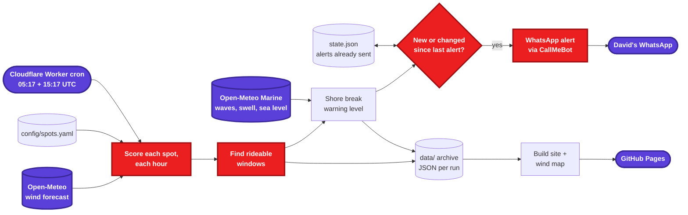
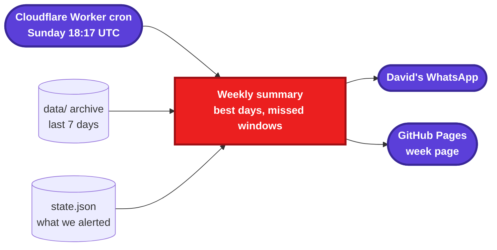
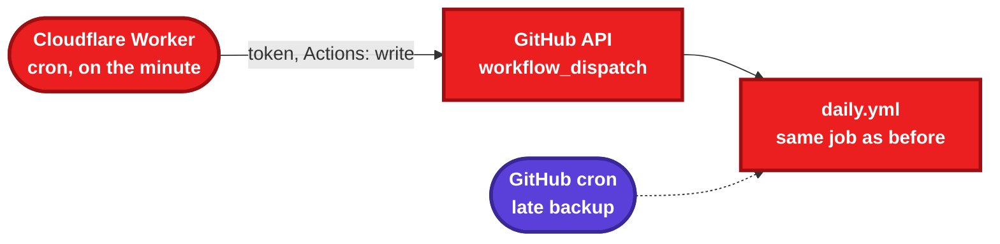
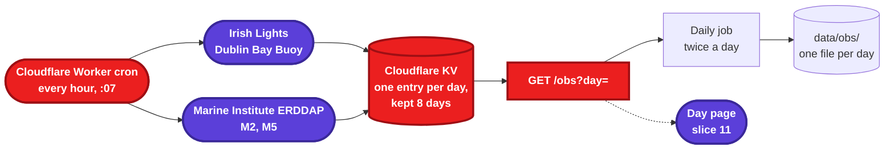

# wing-alert spec

Status: **draft, in review**. Slices are built one PR at a time, in order.

## Goal

Tell the Wicklow wingfoiling crew when the wind is good, where to go, and how dangerous the shore break is. Keep a record of every day so we can look back at what we missed and spot patterns.

- **Push:** a short WhatsApp alert when a spot has a rideable window, with a link to the site. WhatsApp only ever gets alerts and links, never the full report.
- **Pull:** a GitHub Pages site with today's report, a map, and every past day.
- **Look back:** a weekly page on the site. WhatsApp gets a one-line link to it.

It runs on GitHub Actions and free data, with a free Cloudflare Worker as its alarm clock (slice 7). There's no server and no app.

## For the crew: how you'll get the alerts

**The bot can't post in our WhatsApp group.** WhatsApp only lets automated messages into groups through Meta's official business platform. That means a registered business account, approved message templates and paid messages: too much hassle for a hobby project.

What we can do for free:

- **Alerts go to individuals.** Each message goes to one person's WhatsApp, using a free service called CallMeBot. David gets them first. Anyone in the crew who wants their own alerts can register with CallMeBot (about a minute) and give David the key it sends back.
- **A website for everyone.** The daily report, map and spot guide live on a public web page. The link gets pinned in the group, so anyone can check it anytime.
- **Later: Telegram.** A Telegram bot *can* post into a group, with the map image, for free. If the crew is up for a Telegram group, that's the next step.

## Overview

### Daily job (twice a day)



Wind decides **whether** to alert. Waves and tide decide **how loud the warning is**; they never stop an alert.

### Weekly job (Sunday evening)



## Spots

Coordinates come from David's spot guide where it has them, otherwise from OpenStreetMap. Wicklow Harbour is approximate. Good wind directions are where the wind blows **from**, read clockwise round the compass (N → E → S → W). Degrees are for the config: N = 0°, E = 90°, S = 180°, W = 270°.

> **To confirm.** Arklow, Buckroney and Seapoint come from David. Ennereilly, Brittas and Magheramore are proposed from the OpenStreetMap coastline: the range runs from cross-shore on one side, through onshore, to cross-shore on the other. Ennereilly faces SE (no northerly, per David); Brittas and Magheramore face ESE.

| ID | Spot | Lat, Lon | Wind read at (FR-1.11) | Tide station | Good directions (wind from) | Notes |
|---|---|---|---|---|---|---|
| `arklow` | Arklow South Beach / The Cove | 52.7878, -6.1434 | 52.7878, -6.07 | Arklow | NNW → E → SSW (337–202°) | The main spot. Sheltered corner by Arklow Rock |
| `ennereilly` | Ennereilly | 52.837, -6.105 (approx.) | 52.837, -6.05 | Arklow | NE → E → SW (45–225°) | Just south of Buckroney. No northerly |
| `buckroney` | Buckroney | 52.8462, -6.0931 | 52.8462, -6.04 | Arklow | E → S → WSW (90–248°) | Faces WSW-ish: WSW is cross-shore. No northerly. Rocks to the north |
| `brittas` | Brittas Bay | 52.8831, -6.0575 | 52.8831, -5.98 | Arklow (approx., halfway to Wicklow) | NNE → E → SSW (20–200°) | |
| `magheramore` | Magheramore | 52.9310, -6.0225 | 52.931, -5.97 | Wicklow | NNE → E → SSW (20–200°) | Tricky, on the wish list |
| `wicklow_harbour` | Wicklow Harbour | 52.982, -6.035 (approx.) | 52.982, -6.00 | Wicklow | NW → N (280–20°) | Launch from the harbour |
| `seapoint` | Seapoint, Dún Laoghaire | 53.2972, -6.1589 | 53.31, -6.12 | Dublin Port | W → N → E (260–90°) | **Sheltered**: the westerly spot, and the safe option on wild easterly days |

A spot can be marked `sheltered: true` (Seapoint). See FR-4.5.

Each "wind read at" point is the first sea cell of the forecast model off that beach, 3–5 km out (checked 1 Nov 2026 by moving east until the wind jumped).

All spots, thresholds and directions live in `config/spots.yaml` and `config/settings.yaml`, so changing them needs no code change.

## Data sources

| Data | Source | Key? | Used in |
|---|---|---|---|
| Hourly wind speed, gusts, direction (kn) | [Open-Meteo forecast API](https://open-meteo.com/en/docs), `best_match` model, `timezone=Europe/Dublin` | No | Slice 1 |
| Sunrise, sunset | Open-Meteo forecast API (`daily`) | No | Slice 1 |
| Wave height and period, swell height and period | [Open-Meteo Marine API](https://open-meteo.com/en/docs/marine-weather-api) | No | Slice 4 |
| Tide predictions (Arklow, Wicklow, Dublin Port) | [Marine Institute ERDDAP](https://erddap.marine.ie/erddap/tabledap/IMI-TidePrediction.html), `IMI-TidePrediction` | No | Slice 6 |
| Live wind: DLR East Pier station | [Cruising Association of Ireland](https://cruising.ie/dlr-east-pier-weather-station/) | No | Slice 10 |
| Live wind and waves: Dublin Bay Buoy | [Irish Lights MetOcean](https://cilpublic.cil.ie/MetOcean/MetOcean.aspx) | No | Slice 10 |
| Live wind and waves: M2, M5 buoys | [Marine Institute ERDDAP](https://erddap.marine.ie/erddap/tabledap/IWBNetwork.html), `IWBNetwork` | No | Slice 10 |
| WhatsApp delivery | [CallMeBot](https://www.callmebot.com/blog/free-api-whatsapp-messages/): free, unofficial, text only, personal use | API key (secret) | Slice 1 |

Checked on 2026-11-01: both Open-Meteo APIs answer for every spot with no key. The marine grid is coarse: Arklow to Magheramore share one point about 7 km offshore, and Seapoint uses one out in Dublin Bay. That's fine for swell, but too coarse for tides, hence slice 6. Tide predictions are for planning, not navigation.

---

## Slice 1: Forecast, wind check, WhatsApp alert

Branch `feat/wind-alert`.

**Requirements**

- **FR-1.1** Load spots and thresholds from YAML. An invalid config fails the run with a clear message.
- **FR-1.2** For each spot, fetch the hourly forecast for today and the days ahead (Europe/Dublin; `forecast_days`, see FR-9.1): wind speed, gusts, direction in knots, plus sunrise and sunset.
- **FR-1.3** An hour is **good** when all of these hold:
  - mean wind between `min_wind` and `max_wind` (defaults 10 and 40 kn)
  - gusts at or below `max_gust` (default 45 kn)
  - direction inside the spot's good range (ranges may wrap through north, e.g. 280–20°)
  - the whole hour fits between sunrise + 30 min and sunset − 30 min (the 13:00 forecast stands for 13:00–14:00)
  - the hour hasn't already ended (the current hour still counts)
- **FR-1.4** A **window** is at least `min_window_hours` (default 2) consecutive good hours at one spot. It reports the start (first good hour), end (last good hour + 1 h), wind range, max gust and main direction (the circular mean as a 16-point compass name, e.g. ENE).
- **FR-1.5** Rank windows by length, then by mean wind closest to `ideal_wind` (default 20 kn). The best one goes first in the message.
- **FR-1.6** Send one WhatsApp message per run, covering today and tomorrow only (FR-9.2), to each configured recipient, with one short line per window (spot, hours, wind range, direction), grouped by day, best first. No hourly detail: that's on the site. If there are no new windows, send nothing.
- **FR-1.7** Don't repeat yourself. `state.json` keeps, per date, a signature of the windows already sent. Send only when a day's windows are new or have changed, and list only those days. A window that changes by an hour at either end counts as changed. A day whose windows disappear is not reported. Entries older than 14 days are pruned. The workflow commits `state.json` back to the repo.
- **FR-1.8** If a data source fails, retry once, then fail the run. GitHub emails David about failed workflows, so no extra error alert is needed.
- **FR-1.9** Recipients (phone number + CallMeBot key each) come from one secret, `WHATSAPP_RECIPIENTS`, and only ever from environment variables. They never appear in logs, files or the site; error messages name a recipient by position only.
- **FR-1.10** With no recipients configured, the job prints the message instead of sending it and doesn't update `state.json`, so it can run safely before the secret exists. `--dry-run` also skips the archive (FR-2.1): nothing is written at all.
- **FR-1.11** Wind is read at a **sea point** a few km off each beach (`wind_at` in `config/spots.yaml`), not at the beach itself. The forecast model's cell on the beach counts as land, which slows the wind: on 1 Nov 2026 it said 8–9 kn at Arklow while David rode 14–20 kn, and the first sea cell said 17 kn. The beach position is still used for the map and the marine data.
- **FR-1.12** A Cloudflare Worker starts the daily job on time (slice 7). GitHub's own cron stays as a late backup, in case the Worker fails. A run that comes twice is harmless: FR-1.7 stops repeat alerts, and the site shows the latest run.

**Example message**

```
🪁 Wing alert
Thu 6 Nov
• Arklow South Beach 13:00–17:00 · 18–22 kn ENE, gusts 27
• Brittas Bay 14:00–16:00 · 16–19 kn NE, gusts 24
Fri 7 Nov
• Seapoint 10:00–12:00 · 15–18 kn W, gusts 26
```

From slice 2 the message ends with the day page link, and from slice 4 risky windows get ⚠️ or 🚨.

**Schedule:** all times are UTC (an hour later in Irish summer time). The daily job runs at 05:17 and 15:17, the weekly on Sunday at 18:17, all started by the Cloudflare Worker (slice 7). GitHub's cron runs the daily job again at 06:47 and 16:47 as a backup (FR-1.12). A `workflow_dispatch` trigger allows manual runs.

## Slice 2: Daily archive and GitHub Pages site

Branch `feat/site`.

- **FR-2.1** Every daily run writes `data/YYYY/MM/YYYY-MM-DDTHH.json`: the forecast as issued, every hour's scores, and the windows (whole days, including hours already past, ranked as in FR-1.5). Plain JSON, easy to scrape. The workflow commits it.
- **FR-2.2** Every run builds a static site from `data/` (Python + Jinja templates, no framework) and deploys it with GitHub's official Pages actions. The built site is not committed.
- **FR-2.3** **Day page** (one date per page, laid out as in slice 9):
  - top: "Best spot" with its window, or "Nothing rideable"
  - the wind map (from slice 3)
  - a table of all spots ranked, with hourly wind and good hours highlighted
  - a day strip to the days around it (FR-9.4)
- **FR-2.9** If the Pages deploy fails, try once more. The data is already committed by then, so a failed deploy only leaves the site one run behind.
- **FR-2.8** The site works on a phone first. Maps and table: see FR-9.6 and FR-9.7. If the hours don't fit (long summer days), the table scrolls sideways with the spot names pinned on the left.
- **FR-2.4** **Front page** is today's day page. Each date has its own page (FR-9.3); the list of past days is on the All days page (FR-9.8).
- **FR-2.5** The WhatsApp alert ends with a link to the day page.
- **FR-2.6** The site shows "Forecast from Open-Meteo" with a link (required by their terms).
- **FR-2.7** **Spots page:** one section per spot, rendered from `docs/spots/<id>.md` (launch points, parking by wind direction, hazards, seasonal notes, map link). The day page links each spot name to its section. Editing a spot's Markdown file is all it takes to update the page.

**Size check:** about 20 KB of JSON per run plus a 150 KB map per day is roughly 70 MB a year. That's far under the 1 GB Pages and repo guidance.

## Slice 3: Wind map

Branch `feat/wind-map`.

- **FR-3.1** One PNG per hour shown (09:00, 12:00, 15:00, 18:00), each a full map of the coast from Wicklow Harbour to Arklow, sized for a phone screen. The page lays them out (FR-2.8). Seapoint is 40 km further north, so it gets its own small inset map; otherwise the Wicklow spots end up squashed together. The inset sits in the top-left corner, over empty land (Dublin Bay is north and a little west of Wicklow), with a light grey frame, a matching "Dublin Bay" tab in its top-left corner and a small "↑ 40 km north" note under it. The image is cropped to its content, so there is no empty band between the title, the map and the legend.
- **FR-3.2** Each spot has a dot and an arrow pointing where the wind blows **to**, coloured by strength: grey < 10 kn, green 10–20, orange 20–30, red > 30. The label (name, mean/gust in knots) sits on the land side of the dot and the arrow just out at sea, so they never overlap whichever way the wind blows. Labels have no box: the name is dark slate, the numbers bold in the arrow's colour (a shade darker for grey and orange so they stay readable), both with a thin white outline so they read on land and sea. The dot is white with a dark ring. Arrows of spots close together (Buckroney and Ennereilly are 1 km apart) are spread along the coast so they don't touch.
- **FR-3.3** The base map comes from OpenStreetMap coastline data, with attribution on the image.
- **FR-3.4** Each run writes the maps for every date it covers (today and 3 days ahead, FR-9.1) as `data/YYYY/MM/YYYY-MM-DD-HH.png`, overwriting the earlier ones, and the workflow commits them. Past maps never need re-rendering. At about 4 × 45 KB per date, rewritten by every run that covers the date (about 8 runs over 4 days), that's roughly 400 MB a year in git history: fine for a couple of years, and old map versions can be squashed out of history if it ever matters.
- **FR-3.5** The coastline is a simplified OpenStreetMap extract stored in the repo (`wing_alert/assets/coastline.json`), so no map tiles are fetched at run time.
- **FR-3.6** Land and sea have different colours (pale green-sand and blue), so the coast is easy to read. A pale blue band of shallows runs along the sea side of the shore, the way nautical charts show it. Land shapes are built from the same coastline lines: OpenStreetMap keeps land on the left of each way, and this coast faces east, so each open stretch is closed off far inland to the west. Small closed rings are islands.

## Slice 4: Tides, swell, shore break warning

Branch `feat/shore-break`.

- **FR-4.1** For each spot, fetch hourly wave height and period, and swell height and period, from the Marine API. (Tides come from slice 6.)
- **FR-4.2** Find high and low tide times from a sea level curve (peaks and troughs; a flat stretch counts once; swings under 0.2 m are dropped). They stay out of the alert to keep it short. *Replaced by slice 6: the curve now comes from each spot's tide station, not the Marine API's coarse model.*
- **FR-4.3** Give each window a **shore break level**: none, ⚠️ watch out, or 🚨 dangerous. It's based on the worst hour in the window:
  - wave height above the spot's `watch_wave_m` / `danger_wave_m` (defaults 0.8 m / 1.5 m)
  - one level up if the swell period is 10 s or longer (long swell dumps harder)
  - one level up if the tide is at the spot's `worse_at` state (`high`, `low` or `none`; default `none` until the crew tells us). "At high tide" means within 1.5 h of it.
  - the two step-ups only apply when the waves are at least half of `watch_wave_m`, so a flat sea never warns
  - spots can override `watch_wave_m` / `danger_wave_m`; `long_period_s` (10 s) is in the settings
- **FR-4.4** The warning never removes a window. If the Marine API fails, alerts still go out, just without warnings. In the alert it's just the ⚠️ or 🚨 emoji on that window's line; the reasons (swell, period, tide times) are on the day page.
- **FR-4.5** When a day has a 🚨 window at an exposed spot and a `sheltered` spot also has a window that day, the alert adds one line: `Sheltered option: Seapoint 12:00–16:00`.

## Slice 5: Weekly summary

Branch `feat/weekly`.

- **FR-5.1** On Sundays at 18:17 UTC (same workflow, started by the Worker as `job: weekly`; also runnable by hand), read the last 7 days of `data/` (Monday to the run day) and `state.json`.
- **FR-5.2** For each day, take the windows from that day's **morning run** (the shortest-range, most accurate forecast). List the best days and spots of the week.
- **FR-5.3** Mark each window as **alerted** if a sent alert listed an overlapping window at that spot, otherwise **missed** (the forecast didn't see it coming). Alerts are only recorded once `WHATSAPP_RECIPIENTS` is set, so until then every window shows as missed.
- **FR-5.4** Save the summary as `data/weeks/<monday>.json` (state.json forgets after 14 days, so the week is computed once and kept). Publish a week page on the site, linked from the All days page (FR-9.8), and send one WhatsApp line with the link, e.g. `🪁 Week of 3 Nov: 3 good days, 1 missed → <link>`.

---

## Slice 6: Tides per spot

Branch `feat/station-tides`.

Tides along this coast are odd. Near Arklow the main twice-a-day tide almost cancels out (the Irish Sea's tide pivots around a point close to Courtown), so Arklow has a small, lopsided tide with long stands and sometimes a double high water, while Wicklow, Bray and Dublin have a normal one about 2–3 times bigger. On 2 Nov 2026:

| Station | High water | Low water | Range |
|---|---|---|---|
| Arklow | ~05:50, ~17:45 (long stand 10:00–15:00) | ~09:15, ~23:00 | 0.8 m |
| Wicklow | ~04:50, ~17:00 | ~10:15, ~23:25 | 1.9 m |
| Dublin Port | ~05:00, ~17:25 | ~10:25, ~23:30 | 2.7 m |

So one tide line for the whole coast is wrong, and the Marine API's modelled sea level is too coarse to show this.

- **FR-6.1** Tide predictions come from the [Marine Institute](https://erddap.marine.ie/erddap/tabledap/IMI-TidePrediction.html) (ERDDAP dataset `IMI-TidePrediction`, free, no key, 5-minute steps, height above chart datum). Each spot names its station in `config/spots.yaml` (`tide_station`). Each station is fetched once per run, for the forecast days (FR-9.1) plus 3 h either side so tides at midnight are found.
- **FR-6.2** High and low waters are found as in FR-4.2. They feed the shore break rule (FR-4.3), so "worse at high tide" uses the spot's own high water.
- **FR-6.3** The snapshot keeps, per station, its name, the levels every 30 minutes and the high/low waters; each spot records its station.
- **FR-6.4** **Tide chart** on the day page (drawn inside the table since slice 9, FR-9.6), in place of the single "Tides:" line: one line per station over the day (00:00–24:00, height in m), with the hours where any spot is rideable shaded. A small inline SVG, so it scales on a phone and follows dark mode.
- **FR-6.5** **Table:** under each spot name, its station's tides that day, one line each: `HW 05:50 17:45` and `LW 09:15 23:00`. *Replaced by FR-12.1: tags in the cells.*
- **FR-6.6** **Map:** each spot's label adds the tide at that hour: `HW` or `LW` within 1 h of it, otherwise `↑` (rising) or `↓` (falling).
- **FR-6.7** If the tide service fails, the run carries on without tides (no chart, no tide lines, no tide step-up in the shore break), like FR-4.4.

## Slice 7: Reliable schedule

Branch `feat/cloudflare-trigger`.

GitHub's cron is too unreliable to time an alert. GitHub runs scheduled workflows "best effort" from one shared queue, and free public repos have no guarantee. From 2 to 4 Nov 2026, 4 of 12 scheduled runs never ran and the rest started 6 to 8 hours late: the morning alert arrived around 13:00. Runs started by hand or through the API (`workflow_dispatch`) don't wait in that queue: they start within seconds.

So a free Cloudflare Worker is the alarm clock, and GitHub still does all the work.



- **FR-7.1** A Cloudflare Worker (`trigger/`, free plan) has three cron triggers: `17 5 * * *` and `17 15 * * *` (daily) and `17 18 * * SUN` (weekly).
- **FR-7.2** On each trigger it calls GitHub's API to run `daily.yml` on `main` with `job: daily` or `job: weekly`. If the call fails, it retries once, then fails, so the error shows in the Worker's logs.
- **FR-7.3** It authenticates with a fine-grained GitHub token limited to this repo, with only the **Actions: read and write** permission. The token lives only in the Worker's secret `GITHUB_TOKEN`, never in a file, log or commit.
- **FR-7.4** GitHub's cron keeps the daily job at 06:47 and 16:47 as a backup, in case the Worker or its token fails. The weekly job has no GitHub backup: it has no repeat guard, so it must only run once.
- **FR-7.5** The Worker's code stays tiny: a lookup from cron to job, and one API call. The lookup has a unit test (`node --test`) that runs in CI.

## Slice 8: Spot videos

Branch `feat/spot-videos`.

The spot guides list session videos as bare YouTube links. A thumbnail shows what the spot looks like in those conditions at a glance.

- **FR-8.1** In a spot guide, a list item that is only a YouTube link (`youtu.be/<id>`, `youtube.com/watch?v=<id>` or `youtube.com/shorts/<id>`) shows on the spots page as a preview card: the video's thumbnail (`https://i.ytimg.com/vi/<id>/hqdefault.jpg`, lazy-loaded) with the link text as its title, linking to the video on YouTube. No embedded player and no script, so the page stays light however many videos there are. Other links are left as they are.
- **FR-8.2** The cards sit in a grid that wraps: two per row on a phone, more on a wider screen. Adding a video is one more line in the spot's Markdown file.
- **FR-8.3** A guide in `docs/spots/` with no spot in `config/spots.yaml` (e.g. Malahide) is shown at the end of the spots page, marked "No forecast". It gets no forecast, alert or map label.

## Slice 9: Day pages, 3 days ahead, cleaner layout

Branch `feat/day-pages`.

The old day page stacked today and tomorrow, and each block had its own width (best box 1100 px, maps 900, tide chart 640, table as wide as its numbers), so nothing lined up. On a phone the maps and the table both scrolled sideways. Now each date gets one page, the site looks 3 days ahead, and everything sits in one column.

- **FR-9.1** The daily run fetches wind, sea and tides for `forecast_days` (default 4: today + 3) from `config/settings.yaml`. The archive, the maps and the site cover all of them.
- **FR-9.2** Alerts only cover `alert_days` (default 2: today and tomorrow). Forecasts further out move too much: FR-1.7 would re-alert on every shift.
- **FR-9.3** **One page per date.** A date's page comes from the latest run that covers it: the newest run for today and the days ahead, the last run issued that day once it has passed. So the same link starts as an outlook and ends as the record. Days after tomorrow say "Outlook: may still change".
- **FR-9.4** **Day strip** at the top of every day page: 2 days back and 3 ahead, with ‹ › to the next ones. Each day shows the peak wind of its windows (a number in the table's wind colours, or "–" with no window), not a go/no-go light: a marginal 11 kn day must not look like "go". A shore break warning is said in words under it, "⚠️ shore break", orange for watch out and red for dangerous, with the reason on mouseover. The day page itself gives the reason on a phone.
- **FR-9.5** **Order:** day strip, date, best spot, maps, then the table.
- **FR-9.6** **One column.** The best box, maps and table all fill the same width. The tide chart is a row of the table, over the same hours as the table's columns, so the shaded rideable hours sit right over the outlined cells. It stretches to the width, so its labels are written by the page, not drawn in it. Moving the mouse or dragging a finger along it shows a line and each station's height at that time in the Tide cell on the left (not under the finger). Hovering or tapping a table cell grows it a little, lights up its hour, and moves the tide reading to that hour. No zoom when the device asks for reduced motion. On a phone the table fits the screen: no wind arrows, short name column, and each spot's window, waves and tide times on a thin line under its row. *That line is replaced by slice 12.*
- **FR-9.7** **Maps:** the four hours side by side on a wide screen; on a phone one map at a time with hour buttons, opening on the next hour still to come today (12:00 on other days). Without JavaScript they show as a grid.
- **FR-9.8** **All days page**, linked from the header: every date with its peak wind and shore break, and the weekly reports.

## Slice 10: Live readings

Branch `feat/live-readings`.

So far we only know what was forecast, never what actually blew. Buoys near the coast measure wind and waves. Recording them every hour, next to the forecast, lets the site show what's blowing now and lets us later check how good the forecast was. This slice only records; slice 11 shows the readings.



**Stations** (checked 4 Nov 2026):

| ID | Station | Lat, Lon | Near | Source | History at source? |
|---|---|---|---|---|---|
| `east_pier` | DLR East Pier station | 53.3002, -6.1242 | Seapoint, 2 km E | [Cruising Association of Ireland](https://cruising.ie/dlr-east-pier-weather-station/), `eastpier.dublinbaybuoy.com/latest`: the station's own 10-minute mean wind, max gust and direction, in kn. No waves | Only the last 3 hours: we must record it |
| `dublin_bay` | Dublin Bay Buoy | 53.3319, -6.0774 | Seapoint, 7 km NE | [Irish Lights MetOcean](https://cilpublic.cil.ie/MetOcean/MetOcean.aspx): latest reading only, in a JSON field (`latestais`) of the page. Wind in kn, times in UTC | No: we must record it |
| `m2` | M2 weather buoy | 53.4836, -5.4302 | Off north Dublin, 50 km out | [ERDDAP `IWBNetwork`](https://erddap.marine.ie/erddap/tabledap/IWBNetwork.html), hourly | Yes, years |
| `m5` | M5 weather buoy | 51.6904, -6.7043 | Off Wexford, where southerly swell comes into the Irish Sea | ERDDAP `IWBNetwork`, hourly | Yes, years |

No live station was found near the Wicklow spots: Greystones harbour has none that publishes data (only an amateur station inland). Irish Lights has no data buoy between Dublin Bay and Wexford. Irish Lights also has North Kish, South Burford (both off Dublin Bay) and Splaugh (off Rosslare, 60 km south of Arklow, half as far as M5); each is one more entry if we want them.

- **FR-10.1** The Worker from slice 7 gets a fourth cron, `7 * * * *`. On it, it reads every station and stores the readings; it starts no GitHub job.
- **FR-10.2** A reading is: station, `time` (UTC, to the minute, as the source gives it), `wind` and `gust` (kn), `direction` (°, wind from), `wave_height` (m), `wave_period` (s). A value the source leaves out is `null`. The Dublin Bay Buoy gives its latest reading; ERDDAP gives the last 3 hours, so a late or missed run fills in.
- **FR-10.3** Readings are stored in Cloudflare KV under one key per UTC day (`obs:2026-11-04`), grouped by station, sorted by time, one reading per station and time. Each key expires 8 days after its last write; git keeps the history (FR-10.6).
- **FR-10.4** A station that fails (down, changed page, bad value) is logged and skipped; the others are still stored.
- **FR-10.5** The Worker answers `GET /obs?day=2026-11-04` with that day's readings as JSON (`{"day": …, "stations": {"dublin_bay": [readings…]}}`, an empty `stations` if there are none), open to any site (CORS `*`), cached 5 minutes. It's public read-only data, so there's no key. The stations' names and positions are in the answer too, so the page and the daily job need no list of their own.
- **FR-10.6** The daily job fetches yesterday's and today's readings (UTC) and merges them into `data/obs/<day>.json`, keeping readings already there. If the Worker doesn't answer, the run carries on without them.
- **FR-10.7** The station list lives in the Worker (`trigger/src/stations.js`), since the Worker is what reads them. Adding a station is one entry, plus a reader if it's a new kind of source.
- **FR-10.8** The stored data follows rules that later analysis depends on: times in UTC, wind in knots, fixed station IDs, average wind and gust kept apart.

## Slice 11: Measured rows and "Now"

Branch `feat/measured-rows`.

Stations aren't spots: the Dublin Bay Buoy is 7 km off Seapoint, M5 is far south. So the readings get rows of their own under the spots, over the same hours, rather than an "actual" line under each spot. You read down from a spot's forecast to the nearest real reading.

```text
            09  10  11  12  13  14  15  16
Brittas     14  15  17  18  18  16  15  13    ← forecast, as today
Seapoint    ...
─ Measured ──────────────────────────────
Dublin Bay  12  14  16  ·   ·   ·   ·   ·     ← filled in as the hours pass
M2          ...
M5          ...
```

- **FR-11.1** **Measured rows** at the bottom of the day table, under a "Measured" heading, one per station with readings that day (Europe/Dublin), over the table's hours. A cell shows the last reading in that hour: wind in the table's colours, gust small, an arrow for the direction (no arrow on a phone, as for spots). It's never outlined: rideable is a forecast idea. An hour with no reading is empty.
- **FR-11.2** Under the station's name, how far it is from the nearest spot, e.g. `7 km NE of Seapoint`, so nobody reads it as a reading at the spot. The **waves** from the same reading sit in the same cell, under the wind, as for the spots (FR-12.2). The buoys measure waves, not swell on its own (the Dublin Bay Buoy has a swell field, but it's empty). A station without a wave sensor (East Pier) just has no waves in its cells; an hour with waves but no wind shows the waves alone. The footer credits the sources (FR-11.6), and the legend says the readings are not at the spot.
- **FR-11.3** Past days are built from `data/obs/` (FR-10.6), so the comparison stays on the page for good.
- **FR-11.4** **Today's page fetches the latest readings** from the Worker (`/obs`, FR-10.5) when it opens, and fills in the measured wind and waves since the last build. If the Worker doesn't answer, the page keeps what was built.
- **FR-11.5** **Now line** on today's page only, under the best box, from the same fetch: the time of the newest reading and each station's latest wind (and waves where measured), e.g. `Now 14:10 · Dublin Bay 17 kn W, gusts 24, waves 0.6 m · M2 …`. Hidden if there's nothing from the last 3 hours.
- **FR-11.6** **Links to the sources.** Each station's name links to the live page of the source its readings come from, and the footer of every page credits each source by name, with the same link, next to the Open-Meteo and tide credits. The Measured heading is just "Measured". The links live in `config/stations.yaml` (station id → source name and page), so the Worker needs no change. East Pier: [Cruising Association of Ireland](https://cruising.ie/dlr-east-pier-weather-station/); Dublin Bay Buoy: [Irish Lights MetOcean](https://cilpublic.cil.ie/MetOcean/MetOcean.aspx); M2 and M5: [Marine Institute weather buoys](https://www.marine.ie/site-area/data-services/real-time-observations/irish-weather-buoy-network-imos).
- **FR-11.7** **No readings, said nicely.** Once any readings exist, a day page without measured rows still shows the Measured heading, with one grey line under it instead of an empty gap:
  - **future day:** one of three *Back to the Future* lines, picked at random each time the page opens (the first one without JavaScript), ending with that day's name:
    - ⚡ Great Scott! These readings haven't happened yet. Come back on Saturday, or hit 88 mph.
    - 🚗 Readings? Where we're going, we don't need readings. Back on Saturday.
    - ⚡ 1.21 gigawatts won't help: the buoys only measure what's already blown. Back on Saturday.
  - **past day before the first kept readings:** ⚡ No buoy readings: the flux capacitor only came online Wednesday 4 November (the date of the oldest file in `data/obs/`).
  - **past day after that, with nothing kept** (the Worker was down): plainly, "No buoy readings were recorded this day." A real gap gets no joke.
  - **today** is unchanged: its rows show, and hours still to come are simply empty.

## Project layout (planned)

```
config/spots.yaml          spots and directions
config/settings.yaml       thresholds
wing_alert/
  config.py                load + validate YAML
  forecast.py              Open-Meteo client
  scoring.py               good hours, windows, ranking
  message.py               alert text
  whatsapp.py              CallMeBot sender
  state.py                 state.json read/write, change detection
  main.py                  wiring: build parts, run the daily job
tests/
.github/workflows/daily.yml
trigger/                   Cloudflare Worker: starts the jobs (slice 7), records live readings (slice 10)
```

Python 3.12+, `uv`, `httpx`, `pyyaml`, `pytest`, `respx`, `ruff`. Later: `jinja2` (slice 2), `matplotlib` (slice 3).

## Setup David does once

1. Register with CallMeBot: add their number, send "I allow callmebot to send me messages", and receive the API key.
2. Add the repo secret `WHATSAPP_RECIPIENTS`: one `phone:apikey` pair per line (David first, crew members as they register).
3. Turn on GitHub Pages with "GitHub Actions" as the source (slice 2).
4. Create a fine-grained GitHub token (Settings → Developer settings → Fine-grained tokens): repository access **only `daplein/wing-alert`**, permission **Actions: Read and write**, the longest expiry allowed. Put its expiry date in a calendar (slice 7).
5. Create a free Cloudflare account. In `trigger/`, run `npx wrangler login`, then `npx wrangler deploy`, then `npx wrangler secret put GITHUB_TOKEN` (paste the token) (slice 7).
6. In `trigger/`, run `npx wrangler kv namespace create OBS` and put the id it prints in `wrangler.toml` (slice 10). The id isn't secret.

## Slice 12: Tides and waves inside the table

Branch `spec/table-layout` (slices 12 and 13 together).

The grey line under each spot (`08:00–16:00 ⚠️ · waves 1.1 m · HW 09:05 20:55 LW 01:20 13:10`) repeats what the cells already show (the window is the outlined cells, the ⚠️ is beside the name), and "HW/LW" with times is hard to read. A single "waves 1.1 m" for the whole day hides how the sea changes. So the tides and waves move into the table, onto the hours they belong to, and the line goes.

```text
            09     10  11  12  13     14
             High                   Low
Arklow      ←18   ←18  ←19  ←16  ←12  ←16    ← wind
             24    24   26   21   16   22    ← gusts
            ≈0.9  ≈1.0 ≈1.1 ≈1.1 ≈1.0 ≈0.9   ← waves (m), period small on wide screens
```

- **FR-12.1** **Tide tags in the cells.** The spot's cell for the hour nearest each high water gets a small `High` tag on its top edge, clear of the numbers, and the one nearest each low water `Low` (spot's own station, FR-6.2). Plain words, not HW/LW, so nobody needs a tide table to read it. Its title gives the exact time, e.g. `High tide 09:05`. A tide outside the table's hours gets no tag. Replaces FR-6.5.
- **FR-12.2** **Waves in the wind cell.** Each hour's cell shows, under the gust and a thin divider, the forecast wave height from the Marine API (FR-4.1): `≈1.1` with the period small (`4s`). On a phone only the height shows (`1.1`), as the arrows go too. The cell's title adds `· waves 1.1 m every 4 s`. The legend explains it once with 🌊, not an emoji per cell (it would crowd the narrow cells and look different on each phone). A separate waves row took a whole line per spot for two small numbers. Spots that share a marine grid point show the same numbers; that's honest, not a bug.
- **FR-12.3** **No line under the spot.** The window, waves and tide times line goes. The ⚠️ beside the name gets the window and reason as its title, e.g. `10:00–15:00 · Shore break: watch out · 1.1 m waves at 5 s`.

## Slice 13: Hours that stay put, and an hour cursor

When you scroll down to the last spots and the buoys, the hours row is gone, and it's hard to tell which column is which hour.

- **FR-13.1** **Pinned hours.** The hours row stays at the top of the screen while the page scrolls down past the table, and still lines up with the columns when the table scrolls sideways on a phone.
- **FR-13.2** **Hour cursor through the whole table.** Hovering or tapping any cell, or moving along the tide chart, highlights that hour's whole column: the tide chart's line, every spot, its waves line and the measured rows, and the hour in the pinned row. It clears when the mouse leaves the table (a finger leaves it up, as in FR-9.6).

## Non-goals

- No app, no server, no accounts.
- No checking against Windguru or other forecasts. Spot checks are done by hand.
- No WhatsApp groups (not possible with CallMeBot).

## Future work

- Telegram group with the map image itself.
- Model agreement: compare several models (ICON, UKMO, HARMONIE) and show "3/3 agree".
- Met Éireann HARMONIE point forecast as an extra source.
- Use the live readings (slice 10) in the weekly summary: did the forecast windows really happen?
- A live station for the Wicklow spots (Greystones harbour, Arklow harbour or a sailing club), if one with data turns up.
- Short-range "live forecast": the Worker also keeps the next 3 hours of forecast each hour; later an "it's on now" alert when the readings run ahead of the forecast.
- **Forecast vs actual, and patterns:** a script reads `data/` (forecast runs and readings) and works out how far off the forecast is per spot, wind direction and lead time, and patterns such as "the wind backs northerly in spring afternoons" (likely sea breeze). Results as a static page. ERDDAP's buoy history and Open-Meteo's historical forecast API let this start on past years.
- Show sunrise and sunset on the day page (we fetch them already, FR-1.2).
- Crew session log (where, when, how it was) to tune thresholds per spot.
- Suggest where to park and launch by wind direction (e.g. Arklow: P1 in north-easterly, P2 in southerly, P3 when it's 20 kn+ or the shore break is big).
- Seasonal notes from the spot guide to test against the data, e.g. Arklow spring north-westerlies that last for weeks, mostly southerly summers.
- Animated wind map, or a full wind field over the sea.
- WhatsApp images and groups through Meta's official Cloud API.
