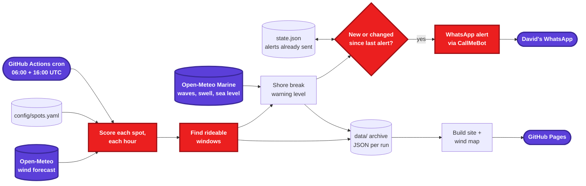
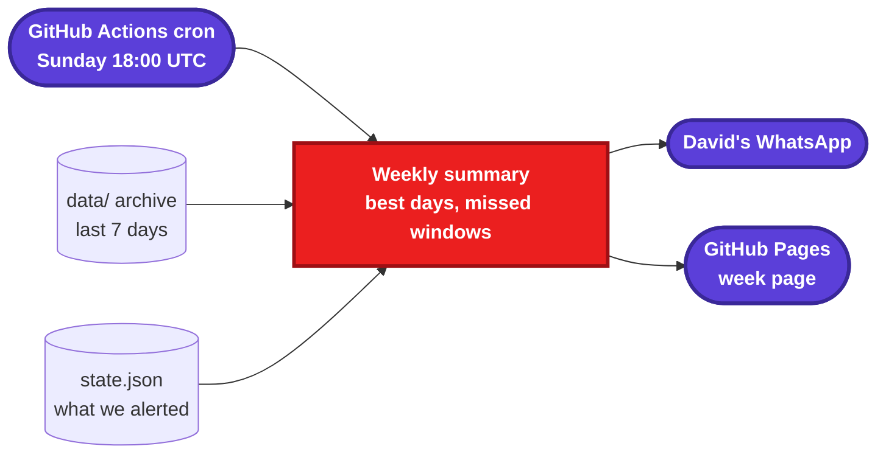

# wing-alert spec

Status: **draft, in review**. Slices are built one PR at a time, in order.

## Goal

Tell the Wicklow wingfoiling crew when the wind is good, where to go, and how dangerous the shore break is. Keep a record of every day so we can look back at what we missed and spot patterns.

- **Push:** a WhatsApp alert to David when a spot has a rideable window.
- **Pull:** a GitHub Pages site with today's report, a map, and every past day.
- **Look back:** a weekly summary.

It runs entirely on GitHub Actions and free data. There's no server and no app.

## Overview

### Daily job (twice a day)



Wind decides **whether** to alert. Waves and tide decide **how loud the warning is**; they never stop an alert.

### Weekly job (Sunday evening)



## Spots

Coordinates are from OpenStreetMap, except Wicklow Harbour, which is approximate. Good wind directions are where the wind blows **from**, in degrees.

> **Proposed directions, to confirm.** The east-facing beaches get N through E to S (cross-shore to onshore). Anything with west in it is offshore there and dangerous.

| ID | Spot | Lat, Lon | Good directions (from) | Notes |
|---|---|---|---|---|
| `arklow` | Arklow South Beach | 52.7871, -6.1437 | 0–190° (N→E→S) | The main spot |
| `ennereilly` | Ennereilly | 52.8461, -6.0973 | 0–190° | |
| `buckroney` | Buckroney | 52.8517, -6.0827 | TBD, takes more westerly | Orientation to work out together |
| `brittas` | Brittas Bay | 52.8831, -6.0575 | 0–190° | |
| `magheramore` | Magheramore | 52.9310, -6.0225 | 0–190° | Tricky, on the wish list |
| `wicklow_harbour` | Wicklow Harbour | 52.982, -6.035 (approx.) | 280–20° (NW→N) | Launch from the harbour |
| `seapoint` | Seapoint, Dún Laoghaire | 53.2972, -6.1589 | 240–300° (W) | The full-westerly option |

All spots, thresholds and directions live in `config/spots.yaml` and `config/settings.yaml`, so changing them needs no code change.

## Data sources

| Data | Source | Key? | Used in |
|---|---|---|---|
| Hourly wind speed, gusts, direction (kn) | [Open-Meteo forecast API](https://open-meteo.com/en/docs), `best_match` model, `timezone=Europe/Dublin` | No | Slice 1 |
| Sunrise, sunset | Open-Meteo forecast API (`daily`) | No | Slice 1 |
| Wave height and period, swell height and period, sea level (tide) | [Open-Meteo Marine API](https://open-meteo.com/en/docs/marine-weather-api) | No | Slice 4 |
| WhatsApp delivery | [CallMeBot](https://www.callmebot.com/blog/free-api-whatsapp-messages/): free, unofficial, text only, personal use | API key (secret) | Slice 1 |

Checked on 2026-11-01: both Open-Meteo APIs answer for Arklow with no key. The marine API snaps to a grid point about 7 km offshore, which is fine for swell. Sea level there is a model value and not for navigation.

---

## Slice 1: Forecast, wind check, WhatsApp alert

Branch `feat/wind-alert`.

**Requirements**

- **FR-1.1** Load spots and thresholds from YAML. An invalid config fails the run with a clear message.
- **FR-1.2** For each spot, fetch the hourly forecast for today and tomorrow (Europe/Dublin): wind speed, gusts, direction in knots, plus sunrise and sunset.
- **FR-1.3** An hour is **good** when all of these hold:
  - mean wind between `min_wind` and `max_wind` (defaults 10 and 40 kn)
  - gusts at or below `max_gust` (default 45 kn)
  - direction inside the spot's good range (ranges may wrap through north, e.g. 280–20°)
  - the hour is between sunrise + 30 min and sunset − 30 min
- **FR-1.4** A **window** is at least `min_window_hours` (default 2) consecutive good hours at one spot. It reports the start, end, wind range, max gust and main direction (compass point, e.g. ENE).
- **FR-1.5** Rank windows by length, then by mean wind closest to `ideal_wind` (default 20 kn). The best one goes first in the message.
- **FR-1.6** Send one WhatsApp message per run listing the windows, grouped by day, best first. If there are no windows, send nothing.
- **FR-1.7** Don't repeat yourself. `state.json` keeps, per date, a signature of the windows already sent. Send only when a day's windows are new or have changed. A window that changes by an hour at either end counts as changed. The workflow commits `state.json` back to the repo.
- **FR-1.8** If a data source fails, retry once, then fail the run. GitHub emails David about failed workflows, so no extra error alert is needed.
- **FR-1.9** Secrets (`WHATSAPP_PHONE`, `CALLMEBOT_API_KEY`) come from environment variables only and never appear in logs, files or the site.

**Example message**

```
🪁 Wing alert
Thu 6 Nov
• Arklow South Beach 13:00–17:00 · 18–22 kn ENE, gusts 27
• Brittas Bay 14:00–16:00 · 16–19 kn NE, gusts 24
Fri 7 Nov
• Seapoint 10:00–12:00 · 15–18 kn W, gusts 26
```

**Schedule:** GitHub cron runs in UTC, so 06:00 and 16:00 UTC is 06:00/16:00 in winter and 07:00/17:00 in summer. GitHub can start scheduled runs 10–30 minutes late; that's acceptable. A `workflow_dispatch` trigger allows manual runs.

## Slice 2: Daily archive and GitHub Pages site

Branch `feat/site`.

- **FR-2.1** Every daily run writes `data/YYYY/MM/YYYY-MM-DDTHH.json`: the forecast as issued, every hour's scores, and the windows. Plain JSON, easy to scrape.
- **FR-2.2** Every run builds a static site from `data/` (Python + Jinja templates, no framework) and deploys it with GitHub's official Pages actions. The built site is not committed.
- **FR-2.3** **Day page:**
  - top: "Best spot" with its window, or "Nothing rideable"
  - the wind map (from slice 3)
  - a table of all spots ranked, with hourly wind and good hours highlighted
  - links to the previous and next day
- **FR-2.4** **Front page** is today's day page, plus a list of past days.
- **FR-2.5** The WhatsApp alert ends with a link to the day page.
- **FR-2.6** The site shows "Forecast from Open-Meteo" with a link (required by their terms).

**Size check:** about 20 KB of JSON per run plus a 150 KB map per day is roughly 70 MB a year. That's far under the 1 GB Pages and repo guidance.

## Slice 3: Wind map

Branch `feat/wind-map`.

- **FR-3.1** One PNG per day: a strip of 4 small maps (09:00, 12:00, 15:00, 18:00) of the coast from Seapoint to Arklow.
- **FR-3.2** Each spot has a dot and an arrow pointing where the wind blows **to**, coloured by strength: grey < 10 kn, green 10–20, orange 20–30, red > 30. Each is labelled with mean and gust in knots.
- **FR-3.3** The base map comes from OpenStreetMap data, with attribution on the image.
- **FR-3.4** The map for a day is committed once (by the last run of that day) as `data/YYYY/MM/YYYY-MM-DD.png`, so past maps don't need re-rendering.

## Slice 4: Tides, swell, shore break warning

Branch `feat/shore-break`.

- **FR-4.1** For each spot, fetch hourly wave height and period, swell height and period, and sea level from the Marine API.
- **FR-4.2** Find high and low tide times for the day from the sea level curve, and show them in the alert and on the day page.
- **FR-4.3** Give each window a **shore break level**: none, ⚠️ watch out, or 🚨 dangerous. It's based on the worst hour in the window:
  - wave height above the spot's `watch_wave_m` / `danger_wave_m` (defaults 0.8 m / 1.5 m)
  - one level up if the swell period is 10 s or longer (long swell dumps harder)
  - one level up if the tide is at the spot's `worse_at` state (`high`, `low` or `none`; default `none` until the crew tells us)
- **FR-4.4** The warning never removes a window. It adds a line to the alert, for example `🚨 Shore break: 1.6 m swell at 11 s, high tide 15:10`.

## Slice 5: Weekly summary

Branch `feat/weekly`.

- **FR-5.1** On Sundays, read the last 7 days of `data/` and `state.json`.
- **FR-5.2** For each day, take the windows from that day's **morning run** (the shortest-range, most accurate forecast). List the best days and spots of the week.
- **FR-5.3** Mark each window as **alerted** if a sent alert listed an overlapping window at that spot, otherwise **missed** (the forecast didn't see it coming).
- **FR-5.4** Send a short WhatsApp summary and publish a week page on the site.

---

## Project layout (planned)

```
config/spots.yaml          spots and directions
config/settings.yaml       thresholds
wing_alert/
  config.py                load + validate YAML
  forecast.py              Open-Meteo client
  scoring.py               good hours, windows, ranking
  message.py               alert text
  whatsapp.py              CallMeBot sender
  state.py                 state.json read/write, change detection
  main.py                  wiring: build parts, run the daily job
tests/
.github/workflows/daily.yml
```

Python 3.12+, `uv`, `httpx`, `pyyaml`, `pytest`, `respx`, `ruff`. Later: `jinja2` (slice 2), `matplotlib` (slice 3).

## Setup David does once

1. Register with CallMeBot: add their number, send "I allow callmebot to send me messages", and receive the API key.
2. Add the repo secrets `WHATSAPP_PHONE` and `CALLMEBOT_API_KEY`.
3. Turn on GitHub Pages with "GitHub Actions" as the source (slice 2).

## Non-goals

- No app, no server, no accounts.
- No checking against Windguru or other forecasts. Spot checks are done by hand.
- No WhatsApp groups (not possible with CallMeBot).

## Future work

- Telegram group with the map image itself.
- Model agreement: compare several models (ICON, UKMO, HARMONIE) and show "3/3 agree".
- Met Éireann HARMONIE point forecast as an extra source.
- Live observations: Marine Institute buoys (M2, M5), the Dublin Bay / Dún Laoghaire buoy near Seapoint. Use them in the weekly "forecast vs what happened".
- Marine Institute tide predictions for Arklow and Wicklow, replacing the modelled sea level.
- **Patterns:** explore the archive and years of Open-Meteo historical data, e.g. "the wind backs northerly in spring afternoons" (likely sea breeze).
- Crew session log (where, when, how it was) to tune thresholds per spot.
- Animated wind map, or a full wind field over the sea.
- WhatsApp images and groups through Meta's official Cloud API.
